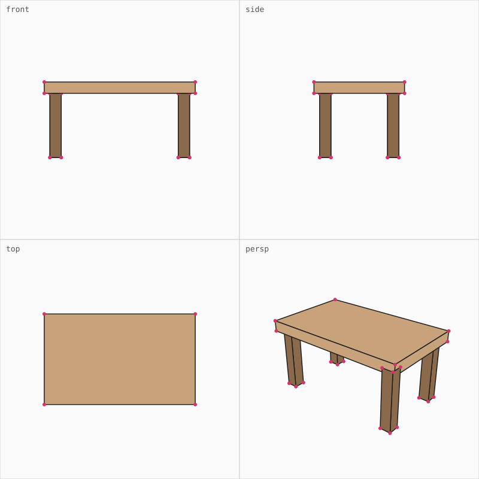

# 3Draft

Minimalist AI first 3D engine.

> Status: **pre-alpha**. The engine is built step by step in this repo.

```sh
npm install 3draft
```

The README has three parts: [1. the engine](#1-the-engine), [2. the viewer app](#2-the-viewer-app) and [3. how the engine and an LLM work together](#3-engine-and-llm).

---

## 1. The engine

A model is plain data, so a human, a program and an LLM can all read and write it:

```js
const mesh = {
  positions: [[0, 0, 0], [1, 0, 0], [1, 1, 0], [0, 1, 0]], // Vec3[], y is up
  faces: [{ v: [0, 1, 2, 3], color: '#c8a27a', mat: 'wood' }], // CCW seen from outside, planar, convex
};
```

A scene is a list of objects `{ id, name, mesh }`. One mesh can hold many differently coloured faces (`examples/cessna.js` is one mesh with 9 colours).

### Rendering

```js
import { box, merge, renderSheet, renderView, orbit, createGpu } from '3draft';

const table = merge(
  box({ size: [2, 0.15, 1.2], at: [0, 0.925, 0], color: '#c8a27a' }),
  box({ size: [0.15, 0.85, 0.15], at: [-0.85, 0.425, -0.45], color: '#8a6a4a' }),
);
renderSheet(table);                           // SVG: front, side, top, persp on one sheet
renderView(table, 'persp', { occlude: true }); // one view, only what is seen
const gpu = await createGpu(canvas);          // WebGPU, same camera, same pixels
gpu.render(table, orbit({ yaw: -0.6, pitch: 0.45 }), { size: 600 });
```



- **SVG** is the deterministic preview (the same calls give the same text). Every `<polygon>` has `data-face` and `data-depth`, every `<circle>` has `data-v`. `occlude: true` paints into a small depth buffer first and sends only the faces and points that are seen (on the 5000-face house: 2793 -> about 680 polygons, 802 KB -> 175 KB, same picture).
- **WebGPU** draws the same scene through the same camera (`viewProjection` is tested to hit the same pixels as `project`), with one shader, one light, real alpha blending (see-through faces in a second pass, sorted far to near) and instancing.
- Cameras: `front`, `side`, `top` (orthographic) and `persp`; `orbit({ yaw, pitch })` is a turntable; any `{ dir, up, ortho }` works.
- Faces are painter-sorted with plane tests; interpenetrating solids can show artifacts, hidden edges are not drawn, back-face culling assumes closed CCW meshes.

### Materials

The palette is data: `{ name: { color, metal, rough, alpha, emit } }`. A face points at an entry with `face.mat`; its `color` stays as the fallback. Editing an entry changes every face made of it.

| field | meaning | drawn as |
|---|---|---|
| `metal` 0..1 | paint ... metal | reflects sky and ground, tinted; strong highlight |
| `rough` 0..1 | mirror ... matte | widens the highlight, blurs the reflection |
| `alpha` 1..0 | solid ... invisible | blended in a second pass, far to near (SVG: `fill-opacity`, and a see-through face hides nothing) |
| `soft` 0..1 | hard ... soft | skin-like light: it wraps round the form, and a warm scattered band shows where light turns to shade (WebGPU) |
| `emit` 0..5 | lit ... glowing | up to 1 the colour fades to unshaded; above 1 (with `tonemap`) it is a light source, that many times brighter |

Pass the palette to the renderers: `renderView(mesh, view, { palette })`, `gpu.render(mesh, view, { palette })` (a new object when an entry changes). SVG shows colour and alpha only.

`gpu.render(mesh, view, { tonemap: true })` switches on a filmic look: lighting in linear colour, HDR light, Fresnel on the edges, ACES tone mapping, and `emit` that really glows above white (`tonemap: { exposure, emit }` to tune; off by default, so the plain look stays the same).

`smooth: true` (or a crease angle in degrees, default 40) shades by corner normals: faces that meet at a shallow angle share their normals, so a faceted surface looks round, and a 90 degree box corner stays sharp (`cornerNormals(mesh, degrees)` is the pure helper). `studio: true` replaces the single sun with three lights that follow the camera: key (upper left), fill (right, softer) and a rim light from behind that edges the shape (`studio: { fill, rim }` to tune). Both are off by default.

### Surfaces, picking, editing

- `pick(mesh, camera, x, y)` casts a real ray: face, point, normal, distance. `ray` is the inverse of `project`; `crosshair` builds a cross lying on the surface; `standOn` returns a prism standing on a picked surface.
- `validate(mesh)` returns text notes: closed shell, winding, planar and convex faces. `extrudeFace`, `moveVertices`, `extrude`, `rotate`, `merge`, `bounds` shape meshes.
- `boolean(a, b, op)` (also `union`, `subtract`, `intersect`) is solid modelling on BSP trees: faces are split by planes, so the result stays convex and planar. Both operands must be closed with outward faces; an open shell (a wall without thickness) is refused with the reason. With `{ strict: false }` the parts that are not closed solids are left out of the calculation instead (a union keeps them as they are, a subtract keeps those of `a`); `health(mesh)` is the check behind it: the connected parts, which are closed, and how many faces a boolean can work with. Face colours and materials are kept; cut faces take the colour of the cutting solid. The result is welded and T-junctions are repaired. A solid stays a solid: a result that is not a closed, consistently wound solid (numerical trouble with coincident faces) is thrown away and the operation is repeated with the second operand nudged by a tiny amount; if no try is sound it throws and the caller keeps the original.
- **Drawing on a mesh** (`wire.ts`): `insertVertex(mesh, face, point)` puts a vertex on a surface (inside a face it makes a triangle fan, on an edge it joins both faces), `cutFace(mesh, a, b)` cuts a face along a line between two of its vertices, `moveVertex(mesh, i, to)` moves one (polygons that use it become triangles, so faces stay planar), `fillLoop(mesh, loop)` closes a loop of vertices into a face, `addLine` and `findLoop` keep the wire (a list of vertex pairs). These are what the viewer's edit mode (`Q`, see [APP.md](APP.md)) uses.
- **HEXAW kernel.** The picking hot loop is also written in [HEXAW](https://github.com/Pengeszikra/hexaw) (`kernel/pick.hexaw`, 569 bytes of WebAssembly). `initKernel()` starts it; `kernel.pick` returns exactly what `pick` returns, 0.14 ms instead of 1.7 ms on 7200 faces. The module is embedded as base64 (`src/kernel-bytes.ts`), so the engine needs neither HEXAW nor a fetch at runtime. `npm run kernel` re-assembles it.

### TypeScript and `|>`

The source is TypeScript (`src/*.ts`) with the F# style pipeline operator, `value |> fn` ([why](https://dev.to/pengeszikra/pipeline-operator-great-again-1cbn)). `npm run build` rewrites every `|>` into plain calls (`scripts/pipe.mjs`: `a |> f |> g(1)` becomes `g(1)(f(a))`) and lets `tsc` check and emit `dist/`, which is committed, so a clone runs without a build.

```ts
const dir = spec.dir |> norm |> times(dist) |> plus(center); // the right side is a function
```

Put arrow functions in parentheses (`x |> ((v) => v + 1)`) and wrap a pipeline in parentheses next to `+` and `-`.

---

## 2. The viewer app

```sh
npm run app     # http://localhost:5173/app/   (repo only, not in the npm package)
```

A single `app/index.html` plus a dependency-free static server. Person and AI work on the same scene: objects loaded from outside and objects made in the viewer are one model, `{ id, name, mesh }`. WebGPU view with an SVG fallback, a cross cursor on the surface, flying, materials, booleans, a move gizmo, isolate, travel, undo. It is also published as a Claude artifact whose shared database is the scene.

**How to use it, all keys and the database layout: [APP.md](APP.md).**

---

## 3. Engine and LLM

The engine is small enough to read whole (about 2000 lines) and everything it works with is text: meshes, palettes and scenes are JSON, previews are SVG, reports are sentences. That is the interface for an LLM:

- **Look.** The LLM renders a model to SVG and reads it (or the numbers in it), without a screenshot. `occlude` keeps the text small.
- **Check.** `validate` / `inspect` say in words what is wrong (open shell, inside-out faces, a non-planar face, which one), so the next edit is targeted.
- **Edit.** The same data goes back in: write documents, call tools, render again. Output is deterministic, so a change in the picture is a change in the model.
- **MCP server.** `mcp/server.js` (stdio, no dependencies) holds a scene of named objects and exposes it as tools: `add_box`, `add_extrusion`, `add_mesh`, `transform`, `boolean`, `recolor`, `remove`, `clear`, `get_mesh`, `extrude_face`, `move_vertices`, `list`, `inspect`, `render`, `pick`, `export`, `import`, `viewer`. It also serves the viewer and pushes every change to it, so a person watches the model grow. `claude mcp add 3draft -- node /absolute/path/to/3Draft/mcp/server.js`
- **Shared database.** In the artifact, the LLM and the person edit the same `objects` and `palette` collections, so either side can start from what the other made.

Y is up, the ground is y = 0, faces are counter-clockwise seen from outside.

Examples: `examples/table.js`, `examples/bridge.js` (50 named objects), `examples/cessna.js` (one mesh, 9 colours), and `examples/head.js` (a stylized head: 7 objects with their own palette, soft skin; try N and K), and `examples/house.js` (a house converted from Blender with `tools/blend/`, 45 objects, approximate colours).

---

## Develop, version, license

```bash
npm run build        # src/*.ts -> dist/ (|> desugared, type checked)
npm test             # builds, then runs every test
npm run build:check  # fails when dist/ is out of date
npm run app          # the viewer
```

Edit `src/*.ts`, never `dist/`. Versions are date based, `YY.MM.DD.NNN`, published as semver `YY.M.DNNN` (`26.11.01.002` is `26.11.1002`); `npm run bump` sets the next one.

MIT
